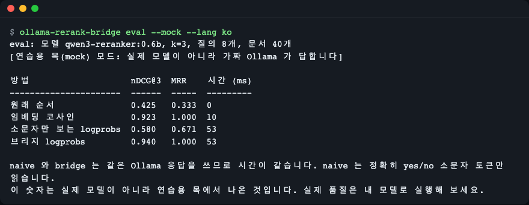
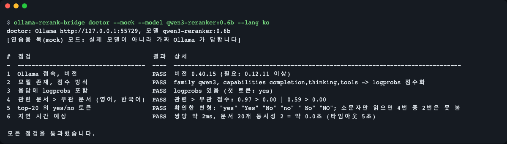
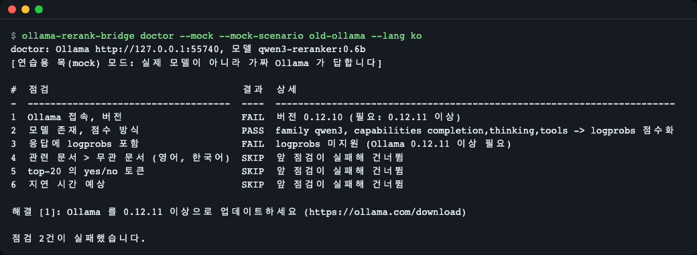
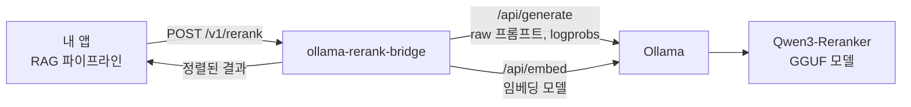

# ollama-rerank-bridge

[English](README.md) | **한국어**

Ollama 에는 리랭크 API 가 없습니다([ollama/ollama#3368](https://github.com/ollama/ollama/issues/3368), 2026-11-24 기준 열려 있음). `ollama-rerank-bridge` 는 이미 돌아가는 Ollama 와 이미 받아 둔 Qwen3-Reranker 모델 위에 Cohere / Jina / vLLM / TEI 호환 `/v1/rerank` 엔드포인트를 붙여 줍니다. 리랭크가 동작할지 미리 점검(`doctor`)하고, 리랭크 전후의 nDCG@k·MRR 을 숫자로 보여 줍니다(`eval`).


*`eval --mock` 은 방법별로 정답 문서를 얼마나 위로 올리는지 표 하나로 보여 줍니다. 이 스크린샷의 숫자는 실제 모델이 아니라 연습용 목에서 나온 것입니다.*

## 이런 분께

- Ollama 위에서 로컬 RAG(Open WebUI, Dify, AnythingLLM, LlamaIndex, LangChain)를 돌리며 두 번째 런타임 없이 리랭커 단계를 붙이고 싶은 분
- Qwen3-Reranker GGUF 를 Ollama 에 넣어 두고, 앱에서 표준 리랭크 API 로 부르고 싶은 분
- "리랭킹이 도움이 됐나?"를 느낌이 아니라 숫자로 확인하고 싶은 분

## 설치

Node.js 20 이상(`brew install node`, 또는 [nodejs.org](https://nodejs.org/))이 필요하고, 실제로 쓰려면 Ollama 0.12.11 이상(`logprobs` 를 돌려주는 버전)이 필요합니다.

```bash
npx ollama-rerank-bridge --version
```

소스에서 설치하려면:

```bash
git clone https://github.com/LeeGyeongPil/ollama-rerank-bridge
cd ollama-rerank-bridge
npm install            # prepare 스크립트가 빌드도 합니다
node dist/src/cli.js --version
```

최소 리눅스 이미지에는 `git` 과 `ca-certificates` 도 필요합니다. 런타임 의존성은 0개입니다.

`--version` 출력:

```text
0.1.2
```

## 빠르게 시작하기 (연습용 목 모드, 모델 불필요)

```bash
npx ollama-rerank-bridge eval --mock --lang ko
```

```text
eval: 모델 qwen3-reranker:0.6b, k=3, 질의 8개, 문서 40개
[연습용 목(mock) 모드: 실제 모델이 아니라 가짜 Ollama 가 답합니다]

방법                    nDCG@3  MRR    시간 (ms)
----------------------  ------  -----  ---------
원래 순서               0.425   0.333  0
임베딩 코사인           0.923   1.000  4
소문자만 보는 logprobs  0.580   0.671  24
브리지 logprobs         0.940   1.000  24

naive 와 bridge 는 같은 Ollama 응답을 쓰므로 시간이 같습니다. naive 는 정확히 yes/no 소문자 토큰만 읽습니다.
이 숫자는 실제 모델이 아니라 연습용 목에서 나온 것입니다. 실제 품질은 내 모델로 실행해 보세요.
```

- **nDCG@3**(정규화 누적 이득): 1.0 은 좋은 문서가 상위 3개에 가장 좋은 순서로 있다는 뜻입니다. **MRR**(평균 역순위): 1.0 은 첫 정답 문서가 항상 1위라는 뜻입니다.
- "원래 순서"는 1차 검색이 돌려준 순서이고, "브리지 logprobs"는 리랭크 후 순서입니다.
- "소문자만 보는 logprobs"는 정확히 `yes`·`no` 토큰만 읽습니다. 브리지는 `Yes`, ` yes`, `YES` 같은 변형도 합산하므로 점수가 더 높습니다.

**목 모드에 대해.** 목은 도구 안에 든 작은 가짜 Ollama 입니다. 단어 겹침으로 지어낸 확률로 답하므로 숫자는 실제 모델 품질이 아닙니다. 실제 모드는 내 Ollama 와 통신하며, 질의-문서 쌍마다 generate 호출을 한 번씩 하므로 느릴 수 있습니다.

## 실제 모델로 쓰기

1. Qwen3-Reranker GGUF 파일(예: Hugging Face 의 "Qwen3-Reranker-0.6B-GGUF" 저장소, 라이선스 확인)을 받아 Modelfile 로 Ollama 에 가져옵니다(이 도구를 만들면서 쓴 방법입니다).

   ```text
   FROM ./Qwen3-Reranker-0.6B-Q4_K_M.gguf
   TEMPLATE {{ .Prompt }}
   ```

   ```bash
   ollama create qwen3-reranker:0.6b -f Modelfile
   ```

2. 동작할지 점검합니다.

   ```bash
   npx ollama-rerank-bridge doctor --model qwen3-reranker:0.6b
   ```

3. 번들 샘플이나 `--data` 로 지정한 내 파일로 측정합니다.

   ```bash
   npx ollama-rerank-bridge eval --model qwen3-reranker:0.6b
   ```

4. 서버를 띄우고 앱이 `http://127.0.0.1:8100/v1/rerank` 를 부르게 합니다.

   ```bash
   npx ollama-rerank-bridge serve --model qwen3-reranker:0.6b
   ```

## 사용법

| 명령·옵션 | 하는 일 | 예 |
|---|---|---|
| `serve` | 리랭크 서버 시작(기본 `127.0.0.1:8100`) | `serve --model qwen3-reranker:0.6b` |
| `doctor` | 해결 힌트가 붙은 사전 점검 6개 | `doctor --model qwen3-reranker:0.6b` |
| `eval` | 방법 4개의 nDCG@k·MRR(임베딩 코사인은 `--embed <m>` 필요) | `eval --model qwen3-reranker:0.6b --k 5 --json` |
| `--mock`, `--mock-scenario` | 가짜 Ollama: `healthy`, `old-ollama`, `no-yesno`, `slow` | `doctor --mock --mock-scenario old-ollama` |
| `--alias 앱이름=모델` | 앱이 보내는 모델 이름을 Ollama 모델로 매핑 | `--alias rerank-v3.5=qwen3-reranker:0.6b` |
| `--scoring` | `auto`, `logprobs`, `embedding` | `--scoring embedding` |
| `--fallback-embed <m>` | logprobs 점수화가 실패하면 임베딩 모델 사용 | `--fallback-embed nomic-embed-text` |
| `--concurrency`, `--timeout`, `--max-chars`, `--max-docs` | 안전 한도(기본 2, 60초, 4000, 200) | `--concurrency 4` |
| `--api-key` | `Authorization: Bearer <키>` 요구 | `--api-key secret` |
| `--host`, `--port` | 브리지 바인드 주소(기본 `127.0.0.1`, `8100`) | `--port 8200` |
| `--embed <m>` | `eval` 의 임베딩 코사인 방식에 쓸 임베딩 모델 | `--embed nomic-embed-text` |
| `--lang en\|ko` | 화면 언어 | `--lang ko` |

### 엔드포인트 호출

다른 터미널에서 `serve --mock` 를 띄워 둔 상태에서:

```bash
curl -s -X POST http://127.0.0.1:8100/v1/rerank -H 'content-type: application/json' -d '{"model":"qwen3-reranker:0.6b","query":"What is the capital of Australia?","documents":["Kangaroos live in Australia.","Canberra is the capital city of Australia.","Sydney has the Opera House."],"top_n":2}'
```

```json
{"id":"rerank-149f4b14-58aa-4e9a-9ead-1c80f641c7b7","model":"qwen3-reranker:0.6b","results":[{"index":1,"relevance_score":0.97},{"index":0,"relevance_score":0.65174456879526}],"usage":{"total_tokens":313},"meta":{"scoring":"logprobs","warnings":["1 of 3 documents used the top-20 floor value for a missing yes/no token"]}}
```

`results` 는 점수 높은 순이고 `index` 는 보낸 `documents` 에서의 원래 위치입니다. `meta.scoring` 은 점수를 어떻게 냈는지 알려 줍니다. `/v2/rerank`(Cohere v2), `/rerank`, TEI 요청 모양(`texts`)도 됩니다. `GET /health` 는 `{"status":"ok"}` 를 돌려줍니다.

### doctor 읽기

```bash
npx ollama-rerank-bridge doctor --mock --model qwen3-reranker:0.6b --lang ko --timeout 5
```


*점검 6개: 버전, 모델, logprobs, 방향(관련 문서 > 무관 문서), yes/no 토큰, 지연 시간.*

```text
#  점검                                  결과  상세
-  ------------------------------------  ----  ---------------------------------------------------------------------------------
1  Ollama 접속, 버전                     PASS  버전 0.40.15 (필요: 0.12.11 이상)
2  모델 존재, 점수 방식                  PASS  family qwen3, capabilities completion,thinking,tools -> logprobs 점수화
3  응답에 logprobs 포함                  PASS  logprobs 있음 (첫 토큰: yes)
4  관련 문서 > 무관 문서 (영어, 한국어)  PASS  관련 > 무관 점수: 0.97 > 0.00 | 0.59 > 0.00
5  top-20 의 yes/no 토큰                 PASS  확인한 변형: "yes" "Yes" "No" "no" " No" "NO"; 소문자만 읽으면 4번 중 2번은 못 봄
6  지연 시간 예상                        PASS  쌍당 약 1ms, 문서 20개 동시성 2 = 약 0.0초 (타임아웃 5초)
```

`타임아웃 5초` 는 위 명령의 `--timeout 5` 때문이며, 생략하면 doctor 와 `serve` 모두 기본값은 60초입니다.

문제가 있으면 무엇을 고칠지 알려 줍니다.


*`--mock-scenario old-ollama` 는 Ollama 0.12.10 인 척합니다. 1·3번이 실패하고 나머지는 건너뛰며 종료 코드는 2 입니다.*

종료 코드: `0` 성공, `1` 사용법 오류, `2` doctor 점검 실패, `3` Ollama 접속 불가.

## 설정

환경변수를 export 하세요. CLI 는 `.env` 를 스스로 읽지 않습니다. `.env` 파일을 쓰려면 `set -a; . ./.env; set +a` 로 셸에 불러오거나 `node --env-file=.env dist/src/cli.js serve` 로 실행하세요. 명령줄 옵션이 환경변수보다 우선합니다.

| 변수 | 기본값 | 뜻 |
|---|---|---|
| `OLLAMA_HOST` | `127.0.0.1:11434` | Ollama 주소(Ollama 와 같은 규칙), `--ollama` 로 덮어씀 |
| `OLLAMA_RERANK_BRIDGE_LANG` | 비어 있음 | 화면 언어 `en` 또는 `ko` |
| `OLLAMA_RERANK_BRIDGE_API_KEY` | 비어 있음 | 브리지 요청에 이 Bearer 키를 요구 |

언어 우선순위: `--lang`, `OLLAMA_RERANK_BRIDGE_LANG`, `LC_ALL`·`LC_MESSAGES`·`LANG` 순입니다. 한국어가 아니면 영어입니다. HTTP 오류 본문은 항상 영어입니다.

서버는 기본으로 `127.0.0.1` 에만 바인드합니다. 다른 주소에 바인드한다면 `--api-key` 를 설정하세요.

## 동작 원리



1. 앱이 Cohere·Jina·vLLM·TEI 모양으로 질의와 문서를 보냅니다. 브리지는 키를 보고 모양을 알아냅니다.
2. 쌍마다 Qwen3-Reranker 모델 카드 프롬프트를 `raw: true`, 출력 1토큰, 상위 20개 `logprobs` 로 `/api/generate` 에 보냅니다.
3. `yes` 변형(대소문자·앞 공백)과 `no` 변형의 확률을 각각 합산해 P(yes) / (P(yes) + P(no)) 를 계산합니다. `Not`·`<think>` 는 무시합니다.
4. 한쪽이 top-20 에 없으면 목록에서 가장 낮은 확률을 상한으로 쓰고 경고를 붙입니다. 둘 다 없으면 점수는 0.5 와 경고입니다.
5. 임베딩 모델은 코사인 유사도로 점수를 냅니다(`/api/embed` 1회).
6. 점수순으로 정렬하고 원래 index 와 함께 돌려줍니다.

점수는 모델 카드의 2토큰 softmax 를 top-20 으로 근사한 값이라 공식 구현과 소수점이 다를 수 있습니다. 중요한 것은 순위입니다.

## 언제 쓰나

- 잘 맞는 경우: 이미 Ollama 를 쓰고, 프로세스 하나만 더해 리랭크 단계를 넣고 싶고, 빠른 통과/실패 점검과 품질 숫자가 필요할 때.
- 다른 도구가 나은 경우: 전용 리랭크 서버나 더 높은 처리량이 필요하면 [Hugging Face Text Embeddings Inference](https://github.com/huggingface/text-embeddings-inference), [vLLM](https://docs.vllm.ai/), [Infinity](https://github.com/michaelfeil/infinity) 를 보세요. 지원하는 모델과 API 는 각 프로젝트 문서를 확인하세요.

빌드 중 프로브의 실제 모델 참고값(Qwen3-Reranker-0.6B Q4_K_M, Apple Silicon CPU, 2026-11-24, 작은 샘플 하나): nDCG@3 이 0.39~0.63(원래 순서, 질의 묶음에 따라 다름)에서 1.00 으로 올랐고, 쌍 하나에 약 70~270ms 걸렸습니다. 벤치마크가 아니라 대략의 참고값입니다.

## 자주 겪는 문제

| 증상 | 원인 | 해결 |
|---|---|---|
| `doctor` 1번 또는 3번 실패 | Ollama 0.12.11 미만은 `logprobs` 가 없음 | Ollama 업데이트 |
| 5번 실패 | 모델의 첫 토큰이 yes/no 가 아님(예: `<think>`) | 모델 카드 템플릿(`TEMPLATE {{ .Prompt }}`)으로 가져온 Qwen3-Reranker 사용 |
| "needs Ollama >= 0.12.11" 과 함께 `502` | 오래된 Ollama 인데 대체 수단 없음 | 업데이트하거나 `--fallback-embed <임베딩 모델>` 추가 |
| `504` | 요청이 `--timeout` 보다 오래 걸림 | `--timeout` 을 늘리거나 문서 수를 줄이거나 `--concurrency` 를 올림 |
| `413` | 문서가 `--max-docs` 보다 많음 | 더 적은 문서를 리랭크하거나 한도를 올림 |
| `401` | `--api-key` 가 설정됨 | `Authorization: Bearer <키>` 를 보냄 |
| 종료 코드 3 | Ollama 접속 불가 | `ollama serve` 를 실행하거나 `--ollama` / `OLLAMA_HOST` 지정 |
| GPU 없는 환경·제한된 환경에서 Ollama 가 모델을 못 띄움 | GPU 초기화 오류 | Ollama 서버를 `LLAMA_ARG_DEVICE=none` 으로 시작(빌드 프로브에서 동작) |

## 개발·기여

```bash
npm install
npm test
```

`npm test` 는 빌드 후 `node --test` 로 테스트 50개를 실행합니다. `npm run test:real` 은 `OLLAMA_RERANK_BRIDGE_REAL_MODEL` 이 설정돼 있으면 실제 모델로 선택 점검을 하고, 없으면 `skipped (no real model)` 을 출력합니다.

버그·제안은 이슈로 남겨 주세요. 변경 기록은 [CHANGELOG.md](CHANGELOG.md).

## 라이선스

MIT. Qwen3-Reranker 모델은 자체 라이선스가 있으니 받는 파일의 모델 카드를 확인하세요.
