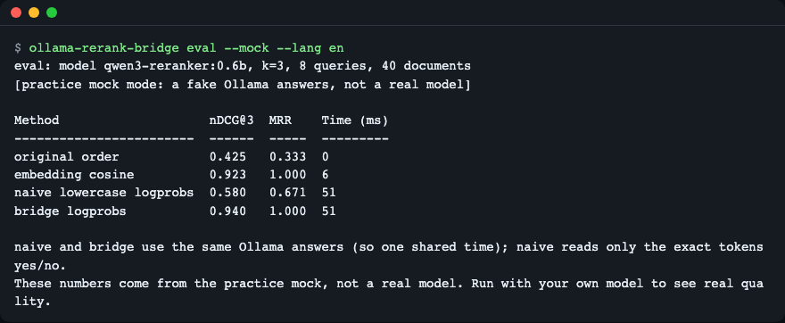
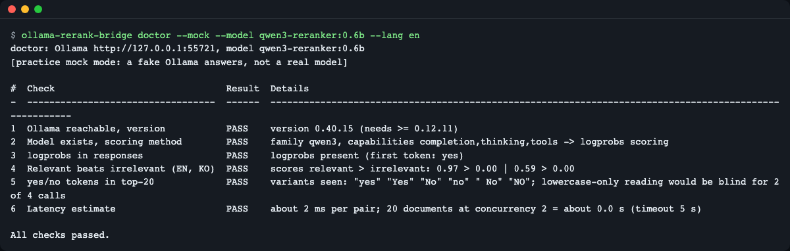
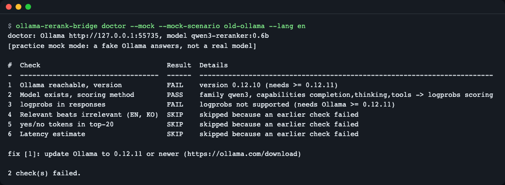
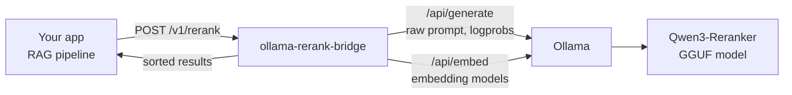

# ollama-rerank-bridge

**English** | [한국어](README.ko.md)

Ollama has no rerank API ([ollama/ollama#3368](https://github.com/ollama/ollama/issues/3368), open as of 2026-11-24). `ollama-rerank-bridge` adds a Cohere / Jina / vLLM / TEI-compatible `/v1/rerank` endpoint on top of the Ollama you already run, using a Qwen3-Reranker model you already pulled. It also checks that reranking will work (`doctor`) and shows nDCG@k and MRR before and after reranking (`eval`).


*`eval --mock` prints one table: how well each method puts the right document first. The numbers in this screenshot come from a practice mock, not a real model.*

## Who this is for

- You run a local RAG stack (Open WebUI, Dify, AnythingLLM, LlamaIndex, LangChain) on Ollama and want a reranker step without starting a second runtime.
- You pulled a Qwen3-Reranker GGUF into Ollama and want your app to call it through a standard rerank API.
- You want a number, not a feeling, for "did reranking help?"

## Install

You need Node.js 20 or newer (`brew install node`, or see [nodejs.org](https://nodejs.org/)) and, for real use, Ollama 0.12.11 or newer (the version that returns `logprobs`).

```bash
npx ollama-rerank-bridge --version
```

Or from source:

```bash
git clone https://github.com/LeeGyeongPil/ollama-rerank-bridge
cd ollama-rerank-bridge
npm install            # also builds, via the prepare script
node dist/src/cli.js --version
```

On a minimal Linux image you also need `git` and `ca-certificates`. The package has zero runtime dependencies.

Output of `--version`:

```text
0.1.2
```

## Quick start (practice mock mode, no model needed)

```bash
npx ollama-rerank-bridge eval --mock
```

```text
eval: model qwen3-reranker:0.6b, k=3, 8 queries, 40 documents
[practice mock mode: a fake Ollama answers, not a real model]

Method                    nDCG@3  MRR    Time (ms)
------------------------  ------  -----  ---------
original order            0.425   0.333  0
embedding cosine          0.923   1.000  4
naive lowercase logprobs  0.580   0.671  24
bridge logprobs           0.940   1.000  24

naive and bridge use the same Ollama answers (so one shared time); naive reads only the exact tokens yes/no.
These numbers come from the practice mock, not a real model. Run with your own model to see real quality.
```

- **nDCG@3** (normalized discounted cumulative gain): 1.0 means the best documents are at the top 3 in the best order. **MRR** (mean reciprocal rank): 1.0 means the first right document is always rank 1.
- "original order" is what your first-stage search returned. "bridge logprobs" is the reranked order.
- "naive lowercase logprobs" reads only the exact tokens `yes` and `no`. The bridge also sums `Yes`, ` yes`, `YES` and so on, which is why it scores higher.

**About the mock.** The mock is a small fake Ollama inside the tool. It answers with made-up probabilities based on word overlap, so its numbers are not real model quality. Real mode talks to your Ollama and can be slow, because it makes one generate call per query–document pair.

## Use it with a real model

1. Download a Qwen3-Reranker GGUF file (for example from the Hugging Face "Qwen3-Reranker-0.6B-GGUF" repositories; check the license) and import it into Ollama with a Modelfile (this is the path used while building this tool):

   ```text
   FROM ./Qwen3-Reranker-0.6B-Q4_K_M.gguf
   TEMPLATE {{ .Prompt }}
   ```

   ```bash
   ollama create qwen3-reranker:0.6b -f Modelfile
   ```

2. Check that it will work:

   ```bash
   npx ollama-rerank-bridge doctor --model qwen3-reranker:0.6b
   ```

3. Measure it on the bundled sample, or your own file with `--data`:

   ```bash
   npx ollama-rerank-bridge eval --model qwen3-reranker:0.6b
   ```

4. Serve it and point your app at `http://127.0.0.1:8100/v1/rerank`:

   ```bash
   npx ollama-rerank-bridge serve --model qwen3-reranker:0.6b
   ```

## Usage

| Command / option | What it does | Example |
|---|---|---|
| `serve` | Start the rerank server (default `127.0.0.1:8100`) | `serve --model qwen3-reranker:0.6b` |
| `doctor` | Six pre-flight checks with fix hints | `doctor --model qwen3-reranker:0.6b` |
| `eval` | nDCG@k and MRR for four methods (embedding cosine needs `--embed <m>`) | `eval --model qwen3-reranker:0.6b --k 5 --json` |
| `--mock`, `--mock-scenario` | Fake Ollama: `healthy`, `old-ollama`, `no-yesno`, `slow` | `doctor --mock --mock-scenario old-ollama` |
| `--alias app=model` | Map a model name your app sends to an Ollama model | `--alias rerank-v3.5=qwen3-reranker:0.6b` |
| `--scoring` | `auto`, `logprobs` or `embedding` | `--scoring embedding` |
| `--fallback-embed <m>` | Use an embedding model if logprobs scoring fails | `--fallback-embed nomic-embed-text` |
| `--concurrency`, `--timeout`, `--max-chars`, `--max-docs` | Safety limits (defaults 2, 60 s, 4000, 200) | `--concurrency 4` |
| `--api-key` | Require `Authorization: Bearer <key>` | `--api-key secret` |
| `--host`, `--port` | Bridge bind address (default `127.0.0.1`, `8100`) | `--port 8200` |
| `--embed <m>` | Embedding model for the `eval` cosine method | `--embed nomic-embed-text` |
| `--lang en\|ko` | Screen language | `--lang ko` |

### Call the endpoint

With `serve --mock` running in another terminal:

```bash
curl -s -X POST http://127.0.0.1:8100/v1/rerank -H 'content-type: application/json' -d '{"model":"qwen3-reranker:0.6b","query":"What is the capital of Australia?","documents":["Kangaroos live in Australia.","Canberra is the capital city of Australia.","Sydney has the Opera House."],"top_n":2}'
```

```json
{"id":"rerank-149f4b14-58aa-4e9a-9ead-1c80f641c7b7","model":"qwen3-reranker:0.6b","results":[{"index":1,"relevance_score":0.97},{"index":0,"relevance_score":0.65174456879526}],"usage":{"total_tokens":313},"meta":{"scoring":"logprobs","warnings":["1 of 3 documents used the top-20 floor value for a missing yes/no token"]}}
```

`results` is sorted by score, highest first, and `index` is the position in your original `documents`. `meta.scoring` tells you how the score was made. `/v2/rerank` (Cohere v2), `/rerank`, and the TEI request shape (`texts`) work too. `GET /health` returns `{"status":"ok"}`.

### Read the doctor

```bash
npx ollama-rerank-bridge doctor --mock --model qwen3-reranker:0.6b --timeout 5
```


*Six checks: version, model, logprobs, direction (relevant beats irrelevant), yes/no tokens, latency.*

```text
#  Check                               Result  Details
-  ----------------------------------  ------  -------------------------------------------------------------------------------------------------------
1  Ollama reachable, version           PASS    version 0.40.15 (needs >= 0.12.11)
2  Model exists, scoring method        PASS    family qwen3, capabilities completion,thinking,tools -> logprobs scoring
3  logprobs in responses               PASS    logprobs present (first token: yes)
4  Relevant beats irrelevant (EN, KO)  PASS    scores relevant > irrelevant: 0.97 > 0.00 | 0.59 > 0.00
5  yes/no tokens in top-20             PASS    variants seen: "yes" "Yes" "No" "no" " No" "NO"; lowercase-only reading would be blind for 2 of 4 calls
6  Latency estimate                    PASS    about 1 ms per pair; 20 documents at concurrency 2 = about 0.0 s (timeout 5 s)
```

The `timeout 5 s` comes from `--timeout 5` in the command above. Without it, doctor and `serve` both default to 60 s.

When something is wrong, it says what to fix:


*`--mock-scenario old-ollama` pretends to be Ollama 0.12.10: checks 1 and 3 fail, the rest are skipped, exit code 2.*

Exit codes: `0` ok, `1` usage error, `2` a doctor check failed, `3` Ollama unreachable.

## Configuration

Export the variables. The CLI does not read `.env` by itself. To use a `.env` file, load it into your shell with `set -a; . ./.env; set +a`, or run with `node --env-file=.env dist/src/cli.js serve`. Options on the command line win over variables.

| Variable | Default | Meaning |
|---|---|---|
| `OLLAMA_HOST` | `127.0.0.1:11434` | Ollama address (same rule as Ollama); `--ollama` overrides |
| `OLLAMA_RERANK_BRIDGE_LANG` | empty | Screen language `en` or `ko` |
| `OLLAMA_RERANK_BRIDGE_API_KEY` | empty | Require this Bearer key on bridge requests |

Language order: `--lang`, then `OLLAMA_RERANK_BRIDGE_LANG`, then `LC_ALL` / `LC_MESSAGES` / `LANG`. Anything that is not Korean falls back to English. HTTP error bodies are always English.

The server binds to `127.0.0.1` by default. If you bind it to another address, set `--api-key`.

## How it works



1. Your app sends a query and documents in a Cohere, Jina, vLLM or TEI shape. The bridge detects the shape from the keys.
2. For each pair, the bridge sends the Qwen3-Reranker model-card prompt to `/api/generate` with `raw: true`, one output token, and `logprobs` with the top 20 alternatives.
3. It sums the probability of every `yes` variant (case, leading space) and every `no` variant, and computes P(yes) / (P(yes) + P(no)). `Not` and `<think>` are ignored.
4. If one of them is missing from the top 20, it uses the lowest listed probability as a ceiling and adds a warning. If both are missing, the score is 0.5 with a warning.
5. Embedding models are scored by cosine similarity instead (one `/api/embed` call).
6. Results are sorted by score and returned with the original indices.

The score is a top-20 approximation of the model card's two-token softmax, so decimals can differ from official implementations. The ranking is what matters.

## When to use it

- Good fit: you already run Ollama, you want a rerank step with one extra process, and you want a quick pass/fail check and a quality number.
- Another tool is better when you want a dedicated rerank server or higher throughput: see [Hugging Face Text Embeddings Inference](https://github.com/huggingface/text-embeddings-inference), [vLLM](https://docs.vllm.ai/) or [Infinity](https://github.com/michaelfeil/infinity). Check each project's docs for the models and APIs it supports.

Real-model reference from the build probe (Qwen3-Reranker-0.6B Q4_K_M, Apple Silicon CPU, 2026-11-24, one small sample): nDCG@3 went from 0.39 to 0.63 (original order, depending on the query set) to 1.00; one pair took about 70 to 270 ms. Treat this as a rough reference, not a benchmark.

## Troubleshooting

| Symptom | Cause | Fix |
|---|---|---|
| `doctor` check 1 or 3 fails | Ollama older than 0.12.11 has no `logprobs` | Update Ollama |
| Check 5 fails | The model's first token is not yes/no (for example `<think>`) | Use a Qwen3-Reranker import with the model-card template (`TEMPLATE {{ .Prompt }}`) |
| `502` with "needs Ollama >= 0.12.11" | Old Ollama and no fallback | Update, or add `--fallback-embed <embedding model>` |
| `504` | Request took longer than `--timeout` | Raise `--timeout`, lower the document count, or raise `--concurrency` |
| `413` | More documents than `--max-docs` | Rerank fewer documents or raise the limit |
| `401` | `--api-key` is set | Send `Authorization: Bearer <key>` |
| Exit code 3 | Ollama not reachable | Run `ollama serve`, or set `--ollama` / `OLLAMA_HOST` |
| Ollama fails to start the model on a GPU-less or restricted machine | GPU initialization error | Start the Ollama server with `LLAMA_ARG_DEVICE=none` (worked in the build probe) |

## Development

```bash
npm install
npm test
```

`npm test` builds and runs 50 tests with `node --test`. `npm run test:real` runs an optional check against a real model when `OLLAMA_RERANK_BRIDGE_REAL_MODEL` is set, and prints `skipped (no real model)` otherwise.

Bugs and ideas are welcome as issues. Changes are listed in [CHANGELOG.md](CHANGELOG.md).

## License

MIT. The Qwen3-Reranker models have their own license; check the model card of the file you download.
